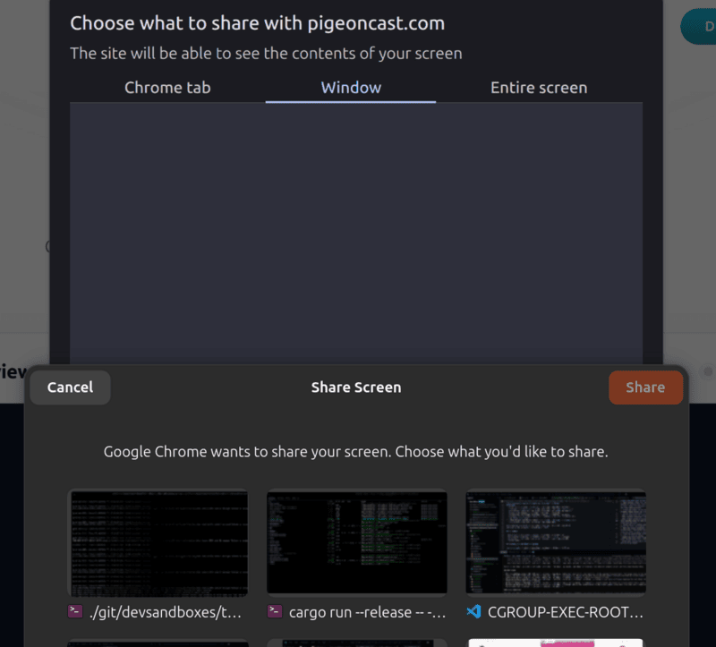

# xdg-desktop-portal-gnome

A backend implementation for [xdg-desktop-portal](http://github.com/flatpak/xdg-desktop-portal)
that is using GTK and various pieces of GNOME infrastructure, such as the
org.gnome.Shell.Screenshot or org.gnome.SessionManager D-Bus interfaces.

## Screen sharing with thumbnails

The stock screen sharing dialog lists windows by title and monitors by name.
With several terminals or browser windows open, those names look alike, and
it's easy to share the wrong thing. This branch shows a live preview of each
choice, so you can pick the right one at a glance:

- **Windows** appear as a grid of cards, each with a thumbnail of the window's
  current contents, its app icon and its title (shortened with "…" when long;
  hover to see the full title).
- **Monitors** show a screenshot of what's on each screen, behind the
  monitor's name.
- Windows that can't be previewed, such as minimized ones, show their app
  icon instead.

Monitor previews come from GNOME Shell's screenshot interface. Window previews
come from a short Mutter screen cast that keeps one frame per window. Because
of that, GNOME Shell's screen sharing indicator shows briefly while previews
load. To keep the cost down, window previews are only taken once you open the
Window page, and only a couple of windows are captured at a time. With many
large windows open, the desktop can still stutter briefly while the previews
load.

## Building xdg-desktop-portal-gnome

xdg-desktop-portal-gnome depends on xdg-desktop-portal and xdg-desktop-portal-gtk.
